# finANTzas
## Manual de Usuario — Android

**Versión instalada:** 1.0 · código de versión 1  
**Identificación en «Acerca de»:** v1.0.0-mvp  
**Fecha de revisión:** 10 de noviembre de 2026  
**Edición:** base documental para maquetación posterior en PDF

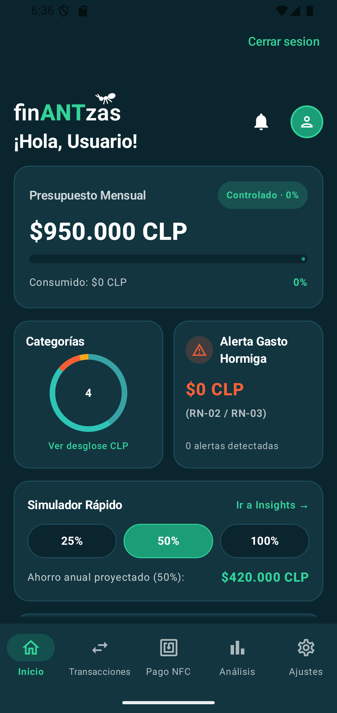

### Contenido

1. Introducción y objetivos
2. Requisitos de utilización
3. Interfaz y navegación
4. Acceso a la cuenta
5. Inicio
6. Transacciones
7. Pago NFC
8. Análisis y simulación
9. Presupuestos y alertas
10. Ajustes
11. Ejemplos verificados
12. Preguntas frecuentes
13. Recomendaciones
14. Conclusiones
15. Cobertura y validación

## 1. Introducción y objetivos

finANTzas permite registrar gastos en pesos chilenos (CLP), revisar su impacto mensual, identificar gastos hormiga y explorar escenarios de ahorro. También incorpora presupuestos por categoría y una billetera NFC de demostración.

Este manual describe la aplicación Android disponible en el proyecto. Los textos de presentación de la aplicación no se consideran por sí solos prueba de una función bancaria, de cumplimiento normativo o de disponibilidad de una plataforma web.

**Cómo interpretar la evidencia:** «Capturado» significa que se abrió y observó una vista real del emulador. «Identificado en código» significa que se revisó su implementación, pero no se ejecutó la operación. Abrir un formulario no verifica que se haya guardado correctamente ni que se haya sincronizado con un servidor.

## 2. Requisitos de utilización

- Android 8.0 (API 26) o posterior, según la configuración del proyecto.
- Aplicación instalada y cuenta para acceder al contenido protegido.
- Conexión a Internet para autenticación y operaciones de sincronización.
- Importes enteros en pesos chilenos, sin decimales.
- Para experimentar con NFC fuera del emulador: dispositivo y entorno compatibles con NFC/HCE. La prueba de cobro en un comercio real no forma parte de esta validación.

La aplicación conserva datos locales y contiene tareas de sincronización. No se ha comprobado en esta revisión el ciclo completo sin conexión, la recuperación posterior de conexión ni el funcionamiento del servicio remoto.

## 3. Interfaz y navegación

En teléfono, la barra inferior contiene cinco opciones:

| Opción | Finalidad |
|---|---|
| Inicio | Consultar el resumen, presupuesto y accesos rápidos. |
| Transacciones | Registrar gastos y consultar el historial. |
| Pago NFC | Preparar una operación NFC de demostración. |
| Análisis | Revisar gráficos, distribución de gastos y simulación de ahorro. |
| Ajustes | Consultar preferencias, perfil, ayuda e información de la aplicación. |

Toque el icono o la etiqueta para cambiar de sección. La opción activa se destaca en verde. Deslice verticalmente el contenido para acceder a tarjetas inferiores; algunos filtros se desplazan horizontalmente. La acción «Cerrar sesión» aparece en la parte superior del contenido autenticado.

En pantallas amplias, el código utiliza un menú lateral con Dashboard, Analytics, Wallet, Goals, Simulator y Settings. Es una presentación distinta, identificada en código y no capturada. No se cambió la configuración del emulador para forzar ese diseño.

## 4. Acceso a la cuenta

**Identificado en código; no ejecutado para conservar la sesión existente.**

### Iniciar sesión

1. Abra finANTzas.
2. Si aparece el formulario de acceso, introduzca su correo electrónico y contraseña.
3. Pulse «Ingresar».
4. Si aparece un mensaje de error, compruebe sus datos y la conexión antes de repetir.

El botón requiere ambos campos completos. La contraseña se presenta oculta.

### Crear una cuenta

1. En el formulario de acceso, pulse «Crear una cuenta nueva».
2. Introduzca el correo y la contraseña.
3. Pulse «Crear cuenta».
4. Si se solicita confirmación por correo, revise su bandeja antes de intentar acceder.
5. «Ya tengo cuenta» permite volver al modo de ingreso.

No se creó ninguna cuenta durante esta revisión. No se identificó un control de recuperación de contraseña en este formulario.

### Cerrar sesión

Pulse «Cerrar sesión» cuando desee salir de su cuenta. El código contiene además esta acción dentro de Ajustes. No se ejecutó para evitar alterar la sesión del emulador.

## 5. Inicio

**Capturado:** figura de portada, `01_inicio.png`.

1. Seleccione «Inicio».
2. Consulte «Presupuesto Mensual», el importe consumido y el porcentaje de utilización.
3. Consulte «Alerta Gasto Hormiga» para conocer el importe y las alertas mostradas.
4. Use «Ver desglose CLP» para acceder al análisis por categorías.
5. En «Simulador Rápido», seleccione 25 %, 50 % o 100 % para explorar una reducción del gasto hormiga.
6. El enlace «Ir a Insights» lleva a la sección «Análisis»; conserva ese texto en esta versión.
7. Desplácese hasta «Transacciones Recientes». «Ver todas» conduce a Transacciones.
8. La campana abre los presupuestos y alertas.

Los accesos y cálculos anteriores se identificaron en el código; no se verificó individualmente cada acceso rápido. El símbolo de perfil de Inicio se presenta como elemento visual, sin acción de edición asociada en esa vista. Para editar el perfil, utilice Ajustes.

**Interpretación de importes:** algunas tarjetas muestran valores de ejemplo cuando no hay movimientos. Por ello, un gráfico o una proyección distinta de cero no demuestra que existan gastos guardados. Consulte siempre el historial para verificar los registros.

## 6. Transacciones

**Capturado:** formulario e historial vacío. Las operaciones de escritura se describen desde el código y no se ejecutaron.

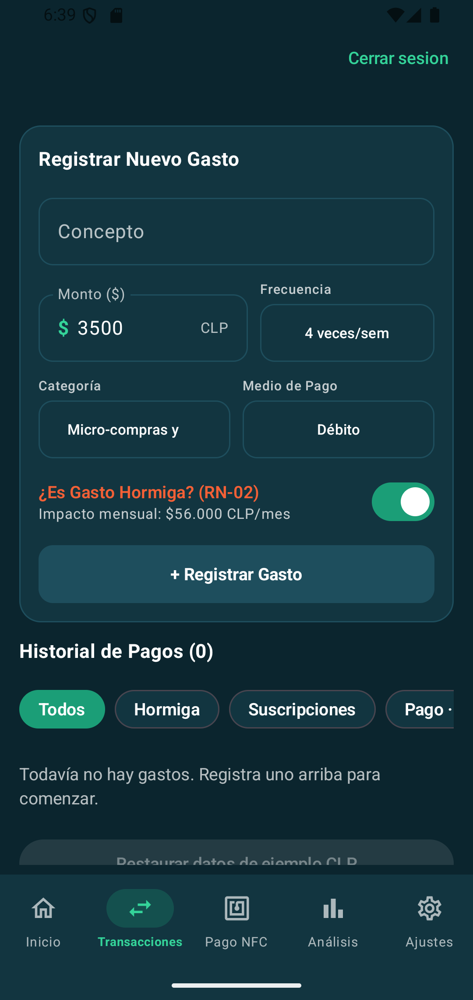

### Registrar un gasto

1. Abra «Transacciones».
2. Escriba un «Concepto» de al menos dos caracteres que identifique el gasto.
3. Introduzca en «Monto ($)» un importe entero mayor que cero.
4. Seleccione la frecuencia: mensual fijo o entre una y siete veces por semana.
5. Elija la categoría: micro-compras y snacks, alimentación y supermercado, vivienda y servicios, transporte y movilidad, o suscripciones de entretenimiento.
6. Seleccione el medio de pago: crédito, débito, efectivo, transferencia o billetera NFC.
7. Revise «¿Es Gasto Hormiga?» y el impacto mensual calculado. Puede corregir la clasificación mediante el interruptor.
8. Pulse «+ Registrar Gasto» cuando los datos sean correctos.
9. Consulte el historial para comprobar el resultado. Si aparece un error, revise el mensaje antes de repetir el envío.

Seleccionar «Billetera NFC» en este formulario registra el medio de pago declarado; no ejecuta por sí mismo una operación sin contacto.

### Entender la clasificación

El motor propone una clasificación por frecuencia de micro-compras y por suscripciones. La confirmación manual permite marcar o desmarcar el gasto. Los códigos RN-01, RN-02 y RN-03 identifican estas reglas; no es necesario memorizarlos para utilizar la aplicación.

### Consultar y filtrar el historial

1. Desplácese hasta «Historial de Pagos».
2. Seleccione «Todos», «Hormiga» o «Suscripciones».
3. Desplace horizontalmente los filtros para acceder a crédito, débito, efectivo, transferencia y NFC.
4. Revise el concepto, categoría, importes y clasificación de cada movimiento disponible.

La captura muestra cero registros. No se añadieron datos para ilustrar tarjetas de movimientos.

### Cambiar una clasificación o eliminar un gasto

El código de cada tarjeta permite cambiar la clasificación hormiga y dispone de una papelera. Para eliminar, la aplicación solicita confirmación mediante «Eliminar gasto»; «Cancelar» descarta la acción. Estas operaciones modifican registros y **no fueron ejecutadas**. No se identificó un formulario general para editar todos los campos de un gasto ya guardado.

### Datos de ejemplo

Existe el botón «Restaurar datos de ejemplo CLP», habilitado únicamente para el usuario local de demostración. No es una acción de consulta: puede modificar los datos de demostración. No se pulsó y no se recomienda utilizarlo para comprobar un historial personal.

## 7. Pago NFC

**Identificado en código. Captura de contenido pendiente por protección de pantalla.**

La vista muestra una tarjeta de demostración, compras predefinidas y campos para monto y comercio. El control principal se llama «Pagar Ahora».

1. Abra «Pago NFC».
2. Revise la compra predefinida o introduzca un monto positivo y un comercio.
3. Compruebe la información antes de continuar.
4. En un entorno de demostración autorizado, «Pagar Ahora» inicia la autorización y preparación de la operación.
5. Si se genera un comprobante, existe la acción «Anular token NFC en RAM» para retirar el token preparado.

**Límites de esta versión:** el código incluye un camino alternativo cuando falla la biometría, que también genera el token e inserta un gasto. Por tanto, no debe interpretarse que un fallo biométrico siempre cancela la operación. Preparar una firma o insertar un registro tampoco demuestra que un comercio haya recibido dinero. No se verificó integración con una red bancaria ni cobro real.

La vista activa una protección de captura (`FLAG_SECURE`). No se deshabilitó ni se modificó para obtener imágenes. No se pulsó «Pagar Ahora», no se generaron tokens y no se capturaron comprobantes sensibles. El indicador de firma de la interfaz no se utiliza como evidencia de un pago probado.

## 8. Análisis y simulación

**Capturados:** resumen, simulador y parte de los gráficos. Interacciones de cálculo identificadas en código.

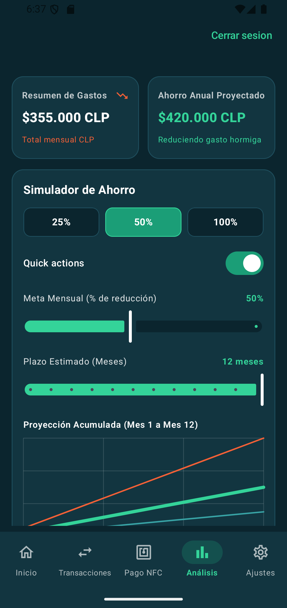

### Consultar los gráficos

1. Seleccione «Análisis».
2. Consulte «Resumen de Gastos» y «Ahorro Anual Proyectado».
3. Desplácese para revisar «Gastos por Categoría y Medios de Pago».
4. Revise el ranking de porcentaje de fuga por medio de pago, cuando esté visible.
5. Continúe hacia el diagrama de distribución de gastos y los presupuestos integrados.

El ranking compara la parte clasificada como gasto hormiga con el total del respectivo medio de pago. No indica una comisión bancaria ni una pérdida de dinero independiente de los gastos registrados.

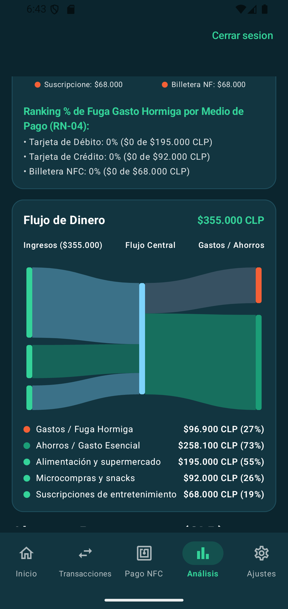

El diagrama utiliza las etiquetas «Ingresos» y «Ahorros / Gasto Esencial» para representar su distribución. Estas etiquetas no prueban ingresos bancarios ni ahorros transferidos: la implementación agrupa impactos de gastos y usa valores ilustrativos cuando no hay movimientos.

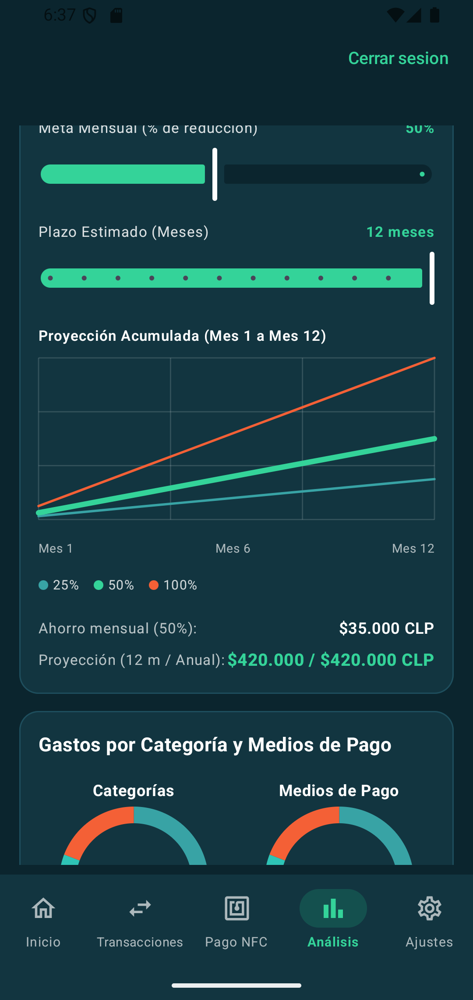

### Explorar un escenario de ahorro

1. Localice «Simulador de Ahorro».
2. Seleccione 25 %, 50 % o 100 % con los botones rápidos.
3. Ajuste «Meta Mensual (% de reducción)» con el deslizador.
4. Ajuste «Plazo Estimado (Meses)» entre uno y doce meses.
5. Compare el ahorro mensual, la proyección del plazo elegido y el ahorro anual.

El interruptor «Quick actions» controla la disponibilidad de las acciones rápidas del simulador. Estos controles exploran escenarios; no constituyen una transferencia a una cuenta de ahorro.

Cuando la base de gasto hormiga es cero, el simulador utiliza una base de ejemplo. En la captura se muestran $35.000 mensuales y $420.000 anuales para 50 %. No deben interpretarse como ahorros personales acreditados.

## 9. Presupuestos y alertas

**Capturado:** panel de presupuestos abierto desde la campana; guardar límites no fue probado.

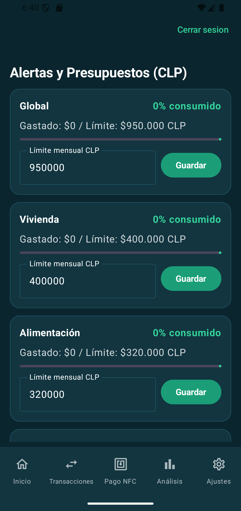

Acceso: campana de Inicio, sección inferior de Análisis o Ajustes → Notificaciones → «Configurar topes por categoría (CLP)».

1. Abra los presupuestos por una de estas rutas.
2. Consulte el límite mensual, consumo y porcentaje de cada categoría.
3. Para cambiar un límite, escriba un entero positivo en «Límite mensual CLP».
4. Pulse «Guardar» únicamente cuando desee modificar ese presupuesto.
5. Revise el mensaje de estado. Guardado local y sincronización remota son resultados distintos.

Las categorías presupuestarias son Global, Vivienda, Alimentación, Transporte, Micro-compras y Entretenimiento. El código establece referencias preventivas desde 75 % y críticas desde 100 %. El límite global no debe confundirse con un ingreso ni con saldo bancario.

## 10. Ajustes

**Capturado:** menú inferior sin datos de cuenta.

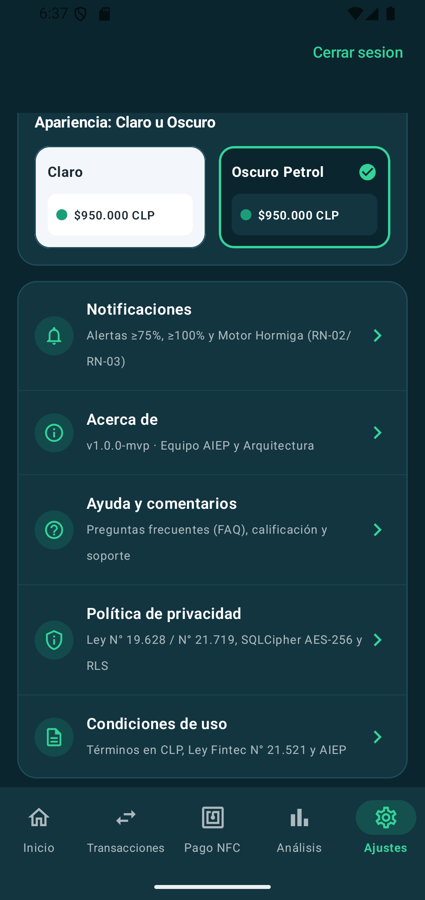

### Perfil y presupuesto base

1. Abra Ajustes y localice «Editar Perfil / CLP» en la tarjeta superior.
2. Introduzca el nombre del titular y el presupuesto mensual global.
3. Pulse «Guardar Cambios» para aplicar la operación.

Identificado en código, no ejecutado. El nombre se mantiene mediante el estado de la aplicación; esta revisión no demuestra que persista después de cerrar el proceso. El presupuesto sí tiene una ruta de guardado local implementada. Se omitió la captura de la tarjeta de cuenta para evitar mostrar información personal.

### Apariencia

En «Apariencia: Claro u Oscuro», toque «Claro» u «Oscuro Petrol». El código cambia el tema en la interfaz. Se documentan ambas opciones sin afirmar persistencia entre ejecuciones; no se cambió la selección existente.

### Notificaciones

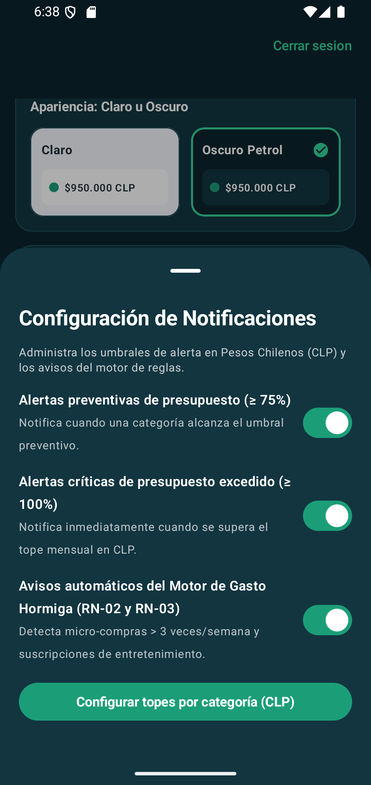

1. Abra «Notificaciones».
2. Revise los interruptores preventivo, crítico y del motor de gasto hormiga.
3. «Configurar topes por categoría (CLP)» despliega el editor de presupuestos.
4. «Ocultar topes por categoría» vuelve a ocultarlo.

El panel fue abierto. Los interruptores mantienen estado de interfaz; no se identificó en sus manejadores una conexión que cambie el motor de alertas o programe avisos del sistema. No se presentan como una función de notificaciones externas comprobada.

### Acerca de

Abra «Acerca de» para consultar versión, propósito y créditos. El panel identifica la edición como v1.0.0-mvp, mientras que Android informa versión 1.0. Sus afirmaciones de arquitectura y normativa son textos de la aplicación, no certificaciones verificadas por este manual.

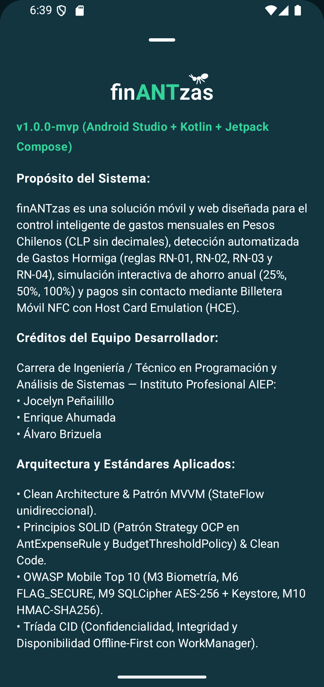

### Ayuda y comentarios

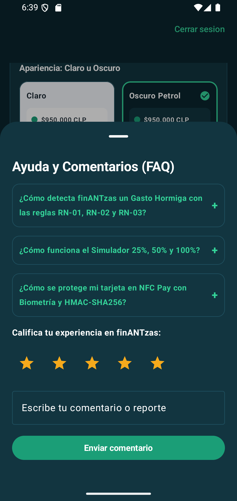

1. Abra «Ayuda y comentarios».
2. Toque una pregunta o su símbolo «+» para desplegar la respuesta.
3. Si desea valorar la experiencia, seleccione de una a cinco estrellas.
4. Escriba hasta 300 caracteres en el comentario.
5. «Enviar comentario» añade la nota a la lista de esa interfaz.

El panel fue capturado sin enviar contenido. La implementación revisada mantiene las notas en memoria: no se identificó envío a un equipo de soporte ni almacenamiento duradero. No incluya información privada esperando un canal de asistencia confidencial.

### Privacidad y condiciones

El menú ofrece «Política de privacidad» y «Condiciones de uso». Abra cada opción y desplácese para leer su contenido. Son paneles informativos; las referencias legales que contienen no fueron objeto de una validación jurídica. Su evidencia visual se detalla en el informe de validación.

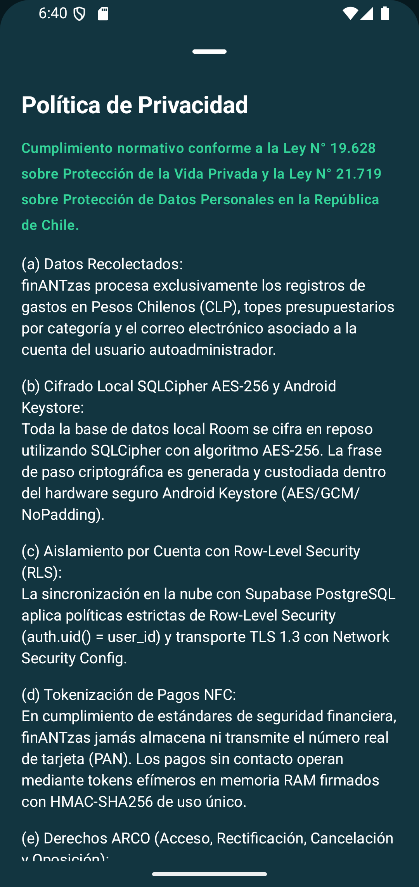

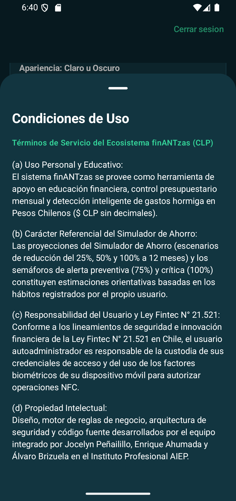

## 11. Ejemplos verificados

### Impacto mensual mostrado sin guardar

La captura de Transacciones muestra un monto de $3.500, frecuencia de cuatro veces por semana e impacto de $56.000 CLP/mes. El cálculo implementado es:

`3.500 × 4 veces por semana × 4 semanas = 56.000 CLP al mes`.

No se ingresó un concepto ni se guardó el gasto. La frecuencia mensual fija utiliza una ocurrencia mensual, en lugar de la multiplicación semanal.

### Proyección visible de demostración

La captura de Análisis muestra $35.000 de ahorro mensual y $420.000 en doce meses para el escenario de 50 %. Se verifica que `35.000 × 12 = 420.000`. La base de ejemplo explica que aparezcan proyecciones aunque el historial esté vacío. No se probó un ahorro monetario real.

## 12. Preguntas frecuentes

**¿Por qué veo gráficos e importes si no tengo gastos?**  
Varias vistas utilizan datos de ejemplo cuando no hay registros. El historial permite distinguirlos de sus propios movimientos.

**¿Puedo introducir centavos?**  
Los importes se manejan como pesos chilenos enteros, sin decimales.

**¿Un gasto pequeño siempre es gasto hormiga?**  
El motor considera frecuencia y tipo de gasto, y permite corrección manual. Revise el interruptor antes de guardar.

**¿Cambiar el simulador modifica mis movimientos?**  
Sus controles cambian el escenario calculado en la interfaz; sus manejadores no guardan movimientos.

**¿«Pagar Ahora» demuestra un cobro real?**  
No. El código prepara una operación y registra un gasto. No se probó una liquidación bancaria.

**¿Mis comentarios llegan al soporte?**  
No se identificó un envío remoto en el formulario revisado. Las notas se mantienen en memoria de la vista.

**¿Cómo sé que un presupuesto se sincronizó?**  
Un mensaje de guardado local con sincronización pendiente no confirma recepción remota. Esa recepción no fue probada en esta revisión.

**¿Puedo recuperar la contraseña desde la pantalla inicial?**  
No se identificó esa opción en el formulario disponible.

## 13. Recomendaciones de utilización

- Revise concepto, frecuencia, categoría y monto antes de guardar.
- Consulte el historial para distinguir movimientos propios de valores ilustrativos.
- Use la clasificación manual cuando la sugerencia no represente su situación.
- Revise periódicamente los topes presupuestarios.
- Interprete el simulador como una estimación basada en los datos y supuestos mostrados.
- No comparta credenciales ni comprobantes con identificadores sensibles.
- Lea los mensajes de error antes de repetir acciones de guardado.
- Evite restaurar datos de ejemplo en un entorno con información que deba conservarse.

## 14. Conclusiones

finANTzas reúne registro de gastos, clasificación de gastos hormiga, presupuestos y herramientas visuales de análisis. Este manual proporciona procedimientos de uso y capturas reales de las vistas comprobadas. La evidencia disponible no valida pagos bancarios, sincronización completa, persistencia de todas las preferencias ni entrega de notificaciones o comentarios a terceros.

## 15. Cobertura y validación

Se identificaron **17 vistas o estados principales**, contando los seis paneles de Ajustes y el simulador como vista funcional reutilizable. No se cuentan menús desplegables, confirmaciones, filtros ni cada variante de tema como pantallas independientes.

| N.º | Vista identificada | Evidencia |
|---|---|---|
| 1 | Presentación inicial | Código; captura pendiente por ser transitoria. |
| 2 | Inicio de sesión | Código; sesión existente conservada. |
| 3 | Crear cuenta | Código; no se creó una cuenta. |
| 4 | Inicio | Captura 01. |
| 5 | Transacciones | Captura 02; historial vacío. |
| 6 | Pago NFC | Código; pantalla protegida, operación no ejecutada. |
| 7 | Análisis | Capturas 03, 04 y 12. |
| 8 | Ajustes | Captura 05; se omite tarjeta personal. |
| 9 | Presupuestos | Captura 11; valores sin editar. |
| 10 | Simulador | Capturas 03 y 04 dentro de Análisis. |
| 11 | Dashboard de tableta | Código; diseño amplio no forzado. |
| 12 | Editar perfil / CLP | Código; no se expusieron datos personales. |
| 13 | Notificaciones | Captura 06; interruptores sin modificar. |
| 14 | Acerca de | Captura 07. |
| 15 | Ayuda y comentarios | Captura 08; formulario sin enviar. |
| 16 | Política de privacidad | Captura 09. |
| 17 | Condiciones de uso | Captura 10. |

El diagrama de flujo, el ranking completo y las tarjetas de presupuestos pueden requerir desplazamiento adicional. No se afirma cobertura visual completa de sus estados. El componente `MonthlyExpenseEntry` existe en el proyecto, pero no se identificó una llamada desde la navegación activa; no se presenta como una pantalla accesible adicional.

La revisión técnica, el inventario de imágenes, sus comprobaciones y las limitaciones se encuentran en [VALIDACION_MANUAL.md](VALIDACION_MANUAL.md). Las rutas de las imágenes son relativas a este archivo para facilitar el traslado conjunto a una herramienta de generación de PDF. No se generó un PDF ni se instalaron dependencias.
